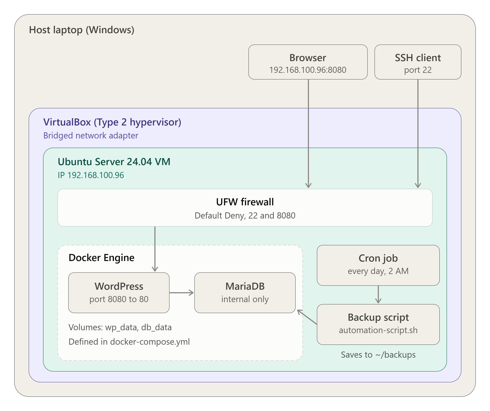

# Operational Manual: (WordPress + MariaDB)

## 1. Overview
This manual is the handover document for the client's IT team. It describes a two-tier private cloud application: a WordPress web tier and a MariaDB database tier, each running in its own Docker container on an Ubuntu Server virtual machine. The server is secured with a UFW firewall using a Default Deny policy, stores its database on persistent volumes so data survives reboots, and backs itself up automatically through a Bash script scheduled with cron.



## 2. Requirements

| Item | Specification |
|---|---|
| Host | Laptop with virtualization (VT-x / AMD-V) enabled |
| Hypervisor | VirtualBox (Type 2) |
| Network | Bridged Adapter (the VM gets its own IP on the LAN) |
| Virtual machine | Ubuntu Server 24.04 LTS, 2 CPU, 2 GB RAM, 25 GB disk  |
| Server name / user | `ccm101` / `ccm101` |
| VM IP address | `192.168.100.96` (assigned by DHCP, so re-check with `hostname -I`) |
| Software | Docker Engine, Docker Compose plugin, UFW, cron, OpenSSH |

## 3. Provisioning the VM
1. Create a new VM in VirtualBox with the Ubuntu Server 24.04 LTS ISO, 2 CPUs, 2 GB RAM, and a 25 GB virtual disk.
2. Set **Settings > Network > Adapter 1** to **Bridged Adapter** and select the host's active network card.
3. Install Ubuntu Server using the whole disk, and enable **Install OpenSSH server**.
4. After the reboot, log in and find the IP address:
   ```bash
   hostname -I
   ```
5. Connect from the host laptop:
   ```bash
   ssh ccm101@192.168.100.96
   ```


## 4. Installing Docker

```bash
sudo apt install -y docker.io docker-compose-v2
```
Log out and SSH back in so the group change applies, then verify:
```bash
docker --version
docker compose version
docker run hello-world
```
The Compose command uses a space (`docker compose`), not a hyphen.


## 5. Deploying the Application

- **Project folder:** `~/cloudnova`
- **Compose file:** `~/cloudnova/docker-compose.yml`
- **Start:** `docker compose up -d`
- **Check:** `docker compose ps`
- **Access:** `http://192.168.100.96:8080`

### Services
| Service | Image | Role |
|---|---|---|
| `db` (cloudnova-db) | `mariadb:10.11` | Database tier. Stores the WordPress data. |
| `wordpress` (cloudnova-wordpress) | `wordpress:latest` | Web tier. Serves the site on host port 8080. |

### Key design decisions
- **Persistent volumes:** `db_data` is mounted at `/var/lib/mysql` and `wp_data` at `/var/www/html`. Data lives outside the containers, so it survives container removal and VM reboots.
- **Restart policy:** `restart: always` brings both containers back after a reboot.
- **Startup order:** `depends_on` starts the database before WordPress.
- **Service discovery:** WordPress reaches the database through `WORDPRESS_DB_HOST: db:3306`. `db` is the service name on the private Compose network.
- **Database not exposed:** the `db` service has no `ports:` section. Only WordPress can reach MariaDB, so port 3306 is never open to the network.
- **Credentials:** the database passwords are set in the compose file as environment variables. They are not repeated in this manual.

### Verifying persistence
```bash
docker compose down
docker compose up -d
```
The test post created in WordPress was still present afterward, and again after `sudo reboot`. `[CONFIRM you tested both]`

> **Warning:** never run `docker compose down -v`. The `-v` flag deletes the data volumes.


## 6. Security Hardening
The server uses host-based security with UFW (Uncomplicated Firewall) and a Default Deny policy. SSH was allowed **before** the firewall was enabled so that administrators were not locked out.

```bash
sudo ufw allow 22/tcp
sudo ufw allow 8080/tcp
sudo ufw default deny incoming
sudo ufw default allow outgoing
sudo ufw enable
sudo ufw status verbose
```

| Port | Purpose | State |
|---|---|---|
| 22/tcp | SSH remote administration | Allowed |
| 8080/tcp | WordPress web application | Allowed |
| 3306/tcp | MariaDB | Closed (and not published by Docker) |
| Everything else incoming | | Denied by default |

**Why Default Deny:** blocking everything and allowing only what the application needs also blocks attacks nobody has seen before. Blocking known bad actors one at a time cannot do that.

**Known limitation:** Docker publishes ports by writing its own iptables rules, which can bypass UFW for published ports. UFW protects the host and every non-Docker service. The database is protected mainly because it is not published at all. For production, bind published ports to localhost behind a reverse proxy, or use the `DOCKER-USER` chain.


## 7. Automation and Backups

| Setting | Value |
|---|---|
| Script | `~/cloudnova/automation-script.sh` |
| Task | Dumps all databases from `cloudnova-db`, compresses with gzip, and removes backups older than 7 days |
| Backup location | `~/backups` (`db_backup_<timestamp>.sql.gz`) |
| Schedule | `0 2 * * *` (every night at 2:00 AM) |
| Log file | `~/backup.log` |

The script is made executable with:
```bash
chmod +x automation-script.sh
```
Files created through the GitHub web page are not executable, so run this after copying the script to a new machine.

### How the script works
- `docker exec ... mariadb-dump` runs the dump inside the database container. It uses the root password from the container's own environment, so no password appears in the script.
- `| gzip` compresses the dump.
- `set -o pipefail` and the `if/else` block make the script report an error, delete the incomplete file, and exit with code 1 if the dump fails.
- `find ... -mtime +7 -delete` removes backups older than 7 days, a simple rotation.

### Cron schedule
```
0 2 * * * /home/ccm101/cloudnova/automation-script.sh >> /home/ccm101/backup.log 2>&1
```

| Field | Value | Meaning |
|---|---|---|
| Minute | 0 | At minute 0 |
| Hour | 2 | At 2 AM |
| Day of month | * | Every day |
| Month | * | Every month |
| Day of week | * | Every day of the week |

`>> backup.log 2>&1` appends the output and any errors to the log file.

> **Time zone note:** the VM clock is set to UTC, and cron uses the VM clock, so 2:00 AM is 2:00 AM UTC (10:00 AM in Manila). To run at 2:00 AM Manila time, run `sudo timedatectl set-timezone Asia/Manila`. 

### Test result
A manual run completed successfully and produced a 1.1 MB compressed backup:
```
[Fri Oct 30 03:27:31 AM UTC 2026] Starting database backup...
[Fri Oct 30 03:27:33 AM UTC 2026] Backup completed: /home/ccm101/backups/db_backup_20261030_032731.sql.gz
[Fri Oct 30 03:27:33 AM UTC 2026] Backups older than 7 days removed.
```

## 8. Maintenance Procedures

| Task | Command |
|---|---|
| View running containers | `docker compose ps` |
| View application logs | `docker compose logs wordpress` |
| Restart the stack | `docker compose restart` |
| Update images | `docker compose pull && docker compose up -d` |
| Run a manual backup | `~/cloudnova/automation-script.sh` |
| List backups | `ls -lh ~/backups` |
| Restore a backup | `gunzip -c ~/backups/FILE.sql.gz \| docker exec -i cloudnova-db sh -c 'exec mariadb -uroot -p"$MYSQL_ROOT_PASSWORD"'` |
| Check the firewall | `sudo ufw status verbose` |
| Check the schedule | `crontab -l` |
| Check the VM IP | `hostname -I` |

> **Warning:** never run `docker compose down -v`. It deletes the data volumes.

## 9. Troubleshooting

| Problem | Likely cause and fix |
|---|---|
| Site does not load | Check `docker compose ps`, the VM IP (`hostname -I`), and `sudo ufw status` |
| Cannot connect over SSH | The VM IP may have changed. Check it, confirm both machines are on the same network, and confirm UFW allows port 22 |
| `permission denied` on docker | Log out and SSH in again after adding the user to the docker group |
| Backup not created | Read `~/backup.log`, check the script is executable, and check the container name is `cloudnova-db` |
| Containers missing after reboot | Run `sudo systemctl enable docker`, then `docker compose up -d` |
| Cron job runs at the wrong hour | The VM clock is UTC. Check with `timedatectl` |

## 10. Security Recommendations
- Use strong, unique passwords or Docker secrets instead of plain environment variables, and keep real passwords out of public repositories.
- Add HTTPS with a reverse proxy.
- Use SSH keys and disable password login.
- Copy backups to another machine, since backups on the same server are lost if it fails.
- Keep the system and images updated (`apt upgrade`, `docker compose pull`).
- Bind published Docker ports to localhost behind a reverse proxy, to avoid the UFW bypass.

